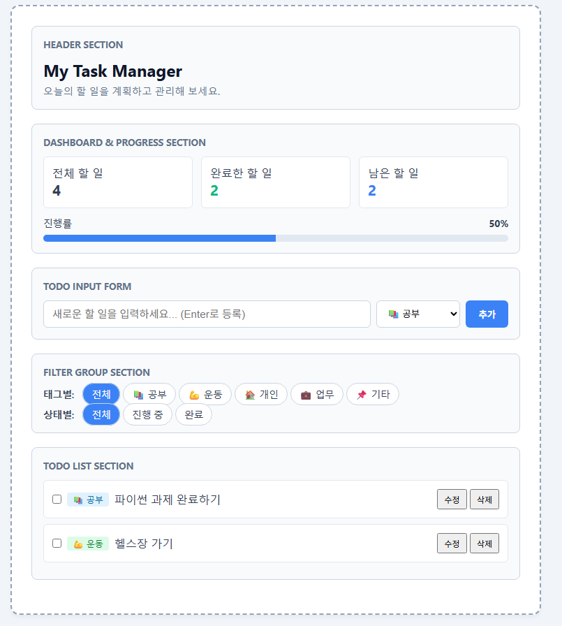
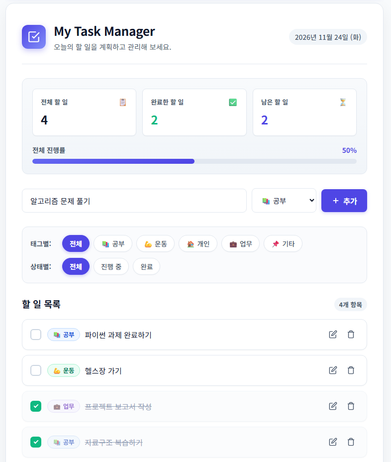
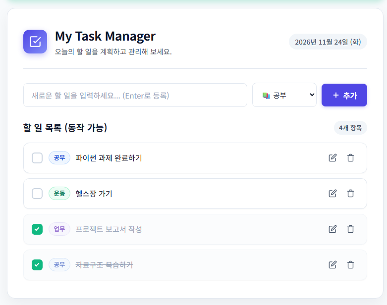
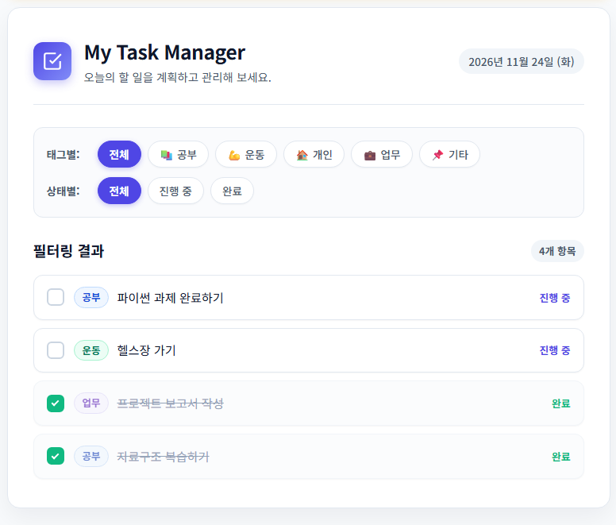
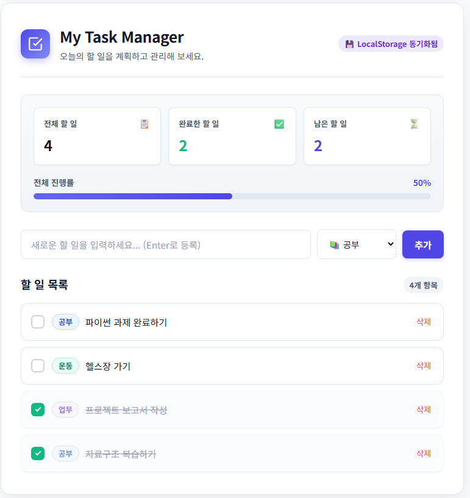
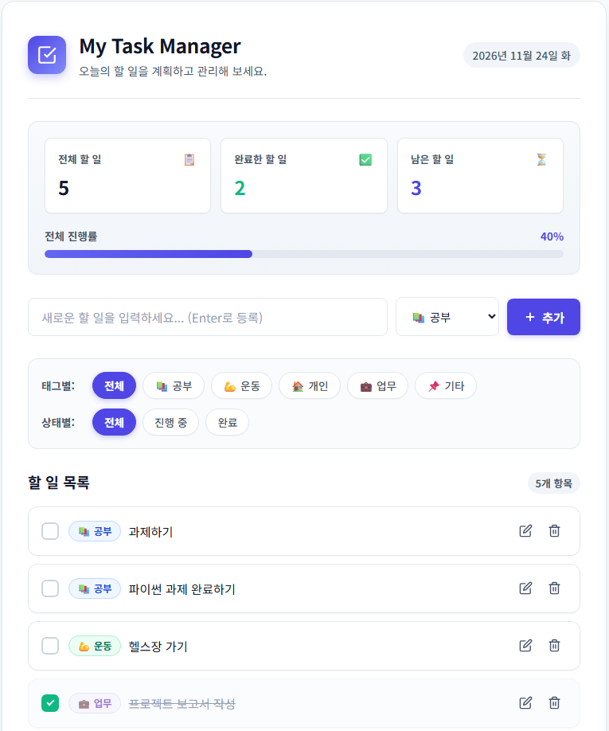

# My Task Manager

공부와 운동 일정을 한 목록에 적어 두면 오늘 남은 과제를 찾기 위해 목록 전체를 읽어야 합니다. My Task Manager는 각 할 일에 태그 하나를 붙이고, 태그와 완료 상태를 조합해 지금 할 일을 골라 볼 수 있게 만든 개인용 웹 앱입니다.

**[프로젝트 소개와 개발 과정](https://hee396311-art.github.io/my-task-manager/about.html)** · **[할 일 관리 앱 실행](https://hee396311-art.github.io/my-task-manager/)**

## 기획과 프롬프트

처음 프롬프트에는 화면 구성, 입력 예시, 예상 결과를 함께 적었습니다. 예를 들어 ‘공부’에는 ‘파이썬 과제 완료하기’와 ‘자료구조 복습하기’가 있고, 복습은 이미 마친 상태입니다. 이때 ‘공부’와 ‘진행 중’을 누르면 파이썬 과제 한 건만 보여야 합니다. 이 예시를 두 필터가 함께 작동하는지 확인하는 기준으로 삼았습니다.

HTML과 CSS로 입력창, 목록, 진행 현황을 구성하고 JavaScript로 할 일의 추가·수정·삭제와 필터를 연결했습니다. 할 일과 완료 상태는 방문자의 브라우저에 저장됩니다. 처음 열면 예시 네 건으로 동작을 확인할 수 있습니다.

## 화면으로 보는 개발 과정

| 1. 화면 구조 설계 | 2. 기본 UI 제작 |
| --- | --- |
| 상단에서 진행률을 확인하고 바로 할 일을 입력할 수 있도록 통계, 입력창, 필터, 목록 순서로 영역을 나눴습니다. | 선택된 필터와 추가 버튼에 보라색을 적용했습니다. 화면에는 ‘알고리즘 문제 풀기’를 입력하는 모습이 담겨 있습니다. |
|  |  |

| 3. 할 일 관리 기능 | 4. 태그와 상태 필터 |
| --- | --- |
| 각 행에 체크박스와 수정·삭제 버튼을 연결했습니다. 완료한 항목은 체크 표시와 취소선으로 구분했습니다. | 두 필터를 나란히 두었습니다. 사진은 ‘전체’에서 네 항목을 보여 주며, 태그와 상태를 선택하면 조건에 맞는 행만 남습니다. |
|  |  |

| 5. 브라우저에 저장 | 6. 남은 일 우선 정렬 |
| --- | --- |
| LocalStorage에 내용을 저장해 다음 방문에도 같은 목록을 불러옵니다. 모든 항목을 지웠다면 빈 목록도 그대로 유지합니다. | ‘과제하기’를 추가한 최종 화면입니다. 전체 5개 중 완료한 일은 2개이므로 진행률은 40%입니다. 남은 3개가 위에 모여 있습니다. |
|  |  |

## 재지시와 회고

처음 만든 목록은 완료한 일과 남은 일이 섞여 있어 다음 할 일을 찾기 불편했습니다. 그래서 재지시할 때 정렬이 바뀌어야 하는 순간까지 구체적으로 적었습니다.

> 체크박스를 클릭해 완료 상태가 변경되면 목록 순서도 즉시 갱신해 주세요.

최종 버전은 미완료 항목을 위에, 완료 항목을 아래에 모읍니다. 같은 상태 안에서는 기존 목록 순서를 유지하고, 필터를 적용해도 같은 규칙이 작동합니다.

프로젝트를 단계로 나누고 각 단계에서 확인할 화면과 동작을 적어 둔 것이 가장 도움이 됐습니다. 특히 정렬을 개선할 때는 사용자가 어떤 조작을 하면 어느 행이 어디로 옮겨가야 하는지 설명한 덕분에 결과를 확인하기 쉬웠습니다.
